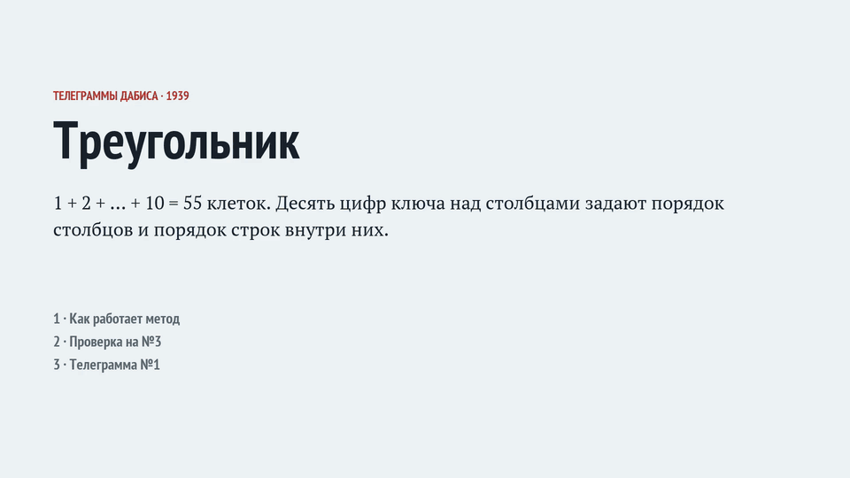

# Телеграммы с линкора «Шлезвиг-Гольштейн» (1939): шифр восстановлен

[](#результат) [](#результат) [](https://scienceblogs.de/klausis-krypto-kolumne/unsolved-ciphertexts-from-world-war-ii-1/) [](README.md) [](LICENSE) [](https://scienceblogs.de/klausis-krypto-kolumne/2021/01/03/drei-weitere-ungeloeste-verschluesselte-nachrichten-vom-kriegsschiff-schleswig-holstein/)

[](https://t.me/hiaimedia) [](https://dzen.ru/hiaimedia)

С января по март 1939 года Гюнтер Дабис, служивший на германском линкоре «Шлезвиг-Гольштейн» (том самом, что 1 сентября 1939 года открыл огонь по Вестерплатте), отправил жене Кете в Киль четыре зашифрованные телеграммы. Клаус Шмех опубликовал их как нерешённые в блоге Cipherbrain в [2017](https://scienceblogs.de/klausis-krypto-kolumne/2017/09/02/who-can-decipher-this-encrypted-telex-from-a-famous-battle-ship/) и [2021](https://scienceblogs.de/klausis-krypto-kolumne/2021/01/03/drei-weitere-ungeloeste-verschluesselte-nachrichten-vom-kriegsschiff-schleswig-holstein/) годах. На трёх бланках сохранилась рукописная расшифровка Кете; на бланке №1 её нет, и №1 никто не прочитал.

В репозитории — восстановленная система, четыре ключа, открытые тексты и код, которым всё это можно проверить независимо.

[English version](README.md)

[](media/triangle_ru.mp4)

*Как работает треугольник: тестовая фраза, проверка на №3 и первое прочтение №1 (49 с; видео в полном разрешении: [media/triangle_ru.mp4](media/triangle_ru.mp4)).*

## Результат

| № | Отправлена | Ключ | Текст, как его зашифровал Дабис | Перевод |
|---|---|---|---|---|
| 1 | 5.01.1939, 18:28 | `0931276845` | ZUR GROSSEN STUNDE HALS UND BEINBRUCH UND X GLATTEN STAPELLAUF M X | «К великому часу — ни пуха ни пера и гладкого спуска на воду!» |
| 2 | 11.01.1939, 20:00 | `1093276548` | LIBSTE KLEINE FRAU BIN SO GLUKLICH U DANKBAR ES LEBE MURX U DIE MUTI | «Любимая маленькая жена, я так счастлив и благодарен. Да здравствуют Муркс и мама!» |
| 3 | 16.02.1939, 19:40 | `2193076458` | BISHER AHNUNGSLOS FEIN DASS ALLES GUT SEHR STOLZ AUF TAPFERE FRAU | «До сих пор ни о чём не знал. Хорошо, что всё благополучно. Очень горжусь храброй женой» |
| 4 | 13.03.1939, 20:15 | `1590276348` | KLEINE BLONDE FRAU NOCH VILE JAHRE MIT DIR VILE FROHE MURXE VON DIR | «Маленькая светловолосая жена, ещё много лет с тобой, много весёлых Мурксов от тебя» |

Murks/Murx — домашнее прозвище ожидаемого ребёнка. Stapellauf — спуск нового корабля на воду; 5 января моряк, по всей видимости, шутит о предстоящих родах (см. «Что не установлено»).

## Система

1. Текст подгоняется ровно под 55 букв (Дабис сокращал слова или добавлял X) и вписывается по строкам, слева направо, в треугольник из 10 строк по 1, 2, …, 10 клеток.
2. Ключ — цифры 0–9 в некотором порядке, они пишутся над десятью столбцами.
3. Столбцы выписываются по порядку цифр: сначала столбец под 0, потом под 1 и так далее.
4. Внутри столбца строки берутся в том порядке, в каком цифры стоят в ключе слева направо. Иначе: строки переставляются по ключу, а затем каждый столбец читается сверху вниз. Пустые клетки пропускаются.
5. 55 букв передаются 11 группами по пять.

Проверка вручную для №1, ключ `0 9 3 1 2 7 6 8 4 5`: цифра 0 стоит над столбцом 0, он идёт первым. Его клетки в порядке строк 0, 9, 3, 1, 2, 7, 6, 8, 4, 5 дают `Z A S U G R N G S E` — первые две группы телеграммы (`ZASUG RNGSE`). Цифра 1 стоит над столбцом 3; его строки в порядке ключа (9, 3, 7, 6, 8, 4, 5) дают `L N H E T N L`, следующие буквы.

## Как проверить

Нужны Python 3.8+ с `numpy` и компилятор C для быстрых программ (`make`).

```bash
make
python verify.py
python known_solve.py
python checks.py blind
python checks.py control 30
python checks.py null 100
python discovery.py
python verify.py --search all
```

Что должно получиться:

1. **`verify.py`.** Обратное шифрование четырёх текстов их ключами даёт переданные шифры с 4 расхождениями на 220 букв: в №1 ни одного; в №2 переставлены две соседние буквы (в группе 9 передано `EEIKO`, по ключу `EEKIO`); в №3 N передана как H; в №4 L передана как I. Лишние H и I читатели блога заметили ещё в 2021 году.
2. **`known_solve.py`.** Решатель считает порядок строк и порядок столбцов двумя независимыми неизвестными и перебирает все 3 628 800 порядков строк при любом порядке столбцов. Для №2, №3 и №4 решение ровно одно, и во всех трёх порядок столбцов обратен порядку строк, то есть оба задаются одним ключом из десяти цифр. Запись Кете для №4, урезанная до 55 букв любым из двух способов, предложенных в 2021 году, решений не имеет.
3. **`checks.py blind`.** Без открытого текста, по оценке модели немецкого языка, верный ключ оказывается первым для всех четырёх телеграмм (у №3 и №4 отрыв от второго места 23 единицы).
4. **`checks.py control 30`.** Так же вскрываются 29 из 30 немецких текстов по 55 букв со случайными ключами.
5. **`checks.py null 100`.** На 100 перемешиваниях букв №1 лучший из 10! ключей даёт бессмыслицу с оценкой −284,2 в медиане и не выше −274,6. Настоящий №1 получает −228,8, далеко за пределами шума. (Разрыв между первым и вторым ключом как довод не годится: на перемешиваниях он доходит до 12,8.)
6. **`discovery.py`.** Если разрезать шифр на подряд идущие куски с буквами целых столбцов треугольника (без учёта порядка внутри столбца), у №2, №3 и №4 остаются 0, 1 и 1 лишняя буква; на 1000 перемешанных текстов — 22–24 в медиане и ни разу меньше 17. Таблицы 5 × 11 и 11 × 5 на уровне шума. Раньше треугольник читали по фиксированным маршрутам, а ключ перемешивает и строки внутри столбцов, поэтому любой фиксированный маршрут проваливается.

## Почему записи Кете не совпадают буква в букву

В шифре ровно те буквы, которые Дабис вписал в треугольник. Кете записывала слова полностью:

| № | Шифр | Дабис | Кете | Разница |
|---|---|---|---|---|
| 2 | 55 | 55 | 60 | у Дабиса LIBSTE, GLUKLICH, MURX, MUTI; у Кете liebste, glücklich, murks, mutti |
| 3 | 55 | 55 | 50 | Кете пропустила SEHR и написала DAS вместо DASS (недостающие E, H, R, S, S) |
| 4 | 55 | 55 | 56 | у Дабиса дважды VILE и MURXE; у Кете viele, viele, murx |

Сверх этого в каждой из №2–№4 есть одна ошибка передачи из списка выше. Исказилась ли буква на линии или при переписывании, установить нельзя.

## Что не установлено

- **Как выбирались ключи.** Все четыре разные. Общее у них есть (цифры 7 и 6 всегда на шестом и седьмом местах; у №2–№4 девятка на третьем месте и восьмёрка в конце; первые цифры №1–№3 — 0, 1, 2), но ни слова, ни имена, ни даты, ни номера телеграмм их не дают. Вероятно, ключи были условлены заранее.
- **M X в конце №1.** Слова занимают 52 буквы; оставшиеся три клетки — X после второго UND (в немецкой военной радиосвязи X обычно ставили вместо точки) и M X в конце, скорее всего заполнители. Что значит M, неизвестно.
- **Stapellauf как роды.** Это прочтение опирается на даты (пожелание 5 января, «es lebe Murx und die Mutti» 11 января) и на комментарий читателя писем ([H.B., 5.01.2021](https://scienceblogs.de/klausis-krypto-kolumne/2021/01/03/drei-weitere-ungeloeste-verschluesselte-nachrichten-vom-kriegsschiff-schleswig-holstein/#comment-1721839)) о том, что ребёнок родился в январе 1939 года. Самих писем (153 страницы из коллекции Патрика Хейса) в сети больше нет.
- **Транскрипция.** BXLTU — первая из 11 групп №2, а не заголовок. Вторая буква группы NLLUI в №1 на скане бледная; расшифровка подтверждает L (HALS).

## Данные и лицензии

- Шифртексты, заголовки и рукописные записи переписаны со сканов, опубликованных на Cipherbrain. Сканы в репозиторий не включены: они принадлежат Тобиасу Шрёделю (№1) и Патрику Хейсу (№2–№4).
- `lm/quad.f32` и `lm/heldout.txt` построены по [Leipzig Corpora Collection](https://wortschatz.uni-leipzig.de/en/download) (CC BY; Goldhahn, Eckart, Quasthoff, LREC 2012) и [Tatoeba](https://tatoeba.org) (CC BY 2.0 FR); `lm/build_lm.py` пересобирает их из корпусов байт в байт.
- Код: лицензия MIT (`LICENSE`).

## Благодарности

Клаусу Шмеху за публикацию телеграмм; Тобиасу Шрёделю и Патрику Хейсу за документы; читателям Cipherbrain, чьи комментарии подготовили почву, особенно Норберту, предложившему треугольник в 2017 году, Михаэлю (BGNC), Герду и Gerry за сравнение рукописных записей с шифрами и Норману К. за даты.
